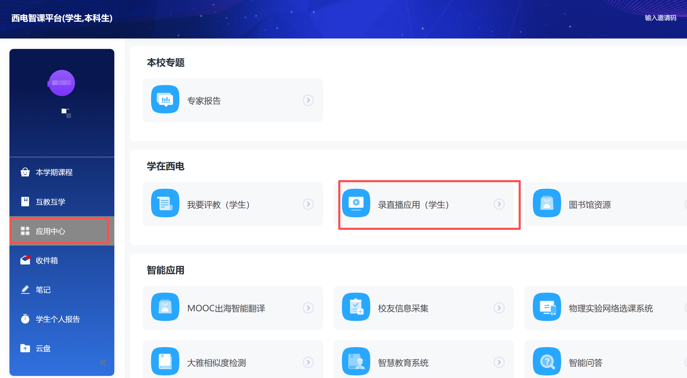
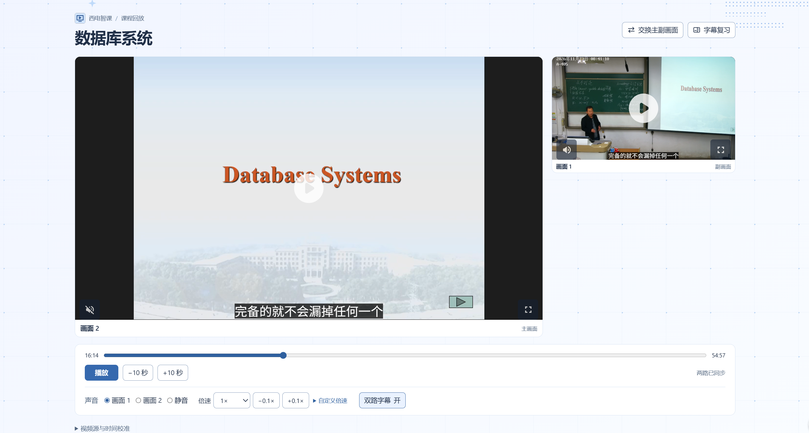
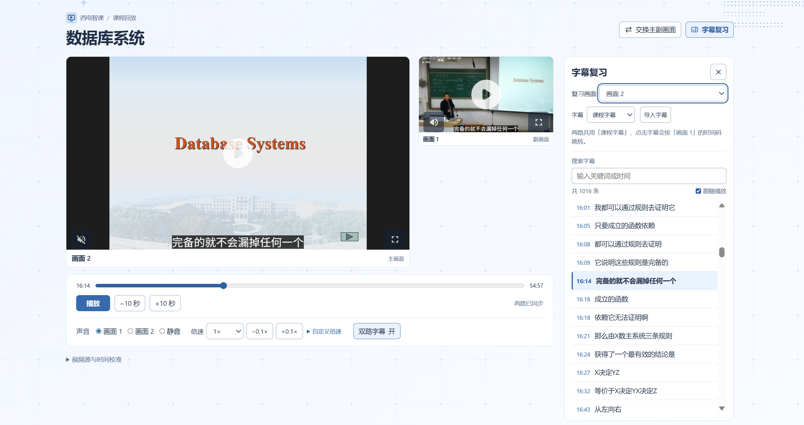

# 录播助手

在电脑上看西电智课回放时，可以让课件和教室画面同步播放，按字幕跳到某句讲解，或把需要的画面保存为 MP4。适用于 Chrome 和 Microsoft Edge 114 及以上版本。

| 想做什么 | 从哪里开始 |
| --- | --- |
| 同时看课件和教室，选择听哪一路 | 扩展面板 → [同步看课](#双路同步看课) |
| 按关键词找讲解，点击字幕回到课堂原句 | 同步播放器右上角 → [字幕复习](#字幕复习) |
| 预览画面，保存一路或两路原片 | 扩展面板 → [下载所选画面](#下载录播) |

## 安装桌面扩展

### 用 ZIP 安装（推荐，适用于 Chrome 和 Edge）

1. 下载 **xdzk-recorder-0.5.1.zip**，解压到一个打算长期保留的文件夹。安装后浏览器会继续从这里读取扩展。[下载 v0.5.1 安装包](https://github.com/Pais1ey/xdzk-video-extension/releases/download/v0.5.1/xdzk-recorder-0.5.1.zip)
2. 在浏览器**地址栏**输入 `chrome://extensions/`（Chrome）或 `edge://extensions/`（Edge），按回车。
3. 开启**开发者模式**，点击**加载已解压的扩展程序**（Load unpacked）。选择刚才解压的文件夹，选中的这一层应能直接看到 `manifest.json`。
4. 扩展列表出现 **西电智课 · 录播下载**，版本显示 **0.5.1**，即安装成功。在浏览器工具栏的扩展菜单中固定它，再刷新已打开的课程回放页。

如果下载的是 GitHub 自动提供的 **Source code (zip)**，解压后请选择仓库里的 `extension` 子文件夹。已经装过 v0.6.0 的用户可以先在扩展管理页停用旧版，再按上面的步骤从新文件夹加载 v0.5.1。[Edge 官方安装图解](https://learn.microsoft.com/zh-cn/microsoft-edge/extensions/getting-started/extension-sideloading)

### 用签名 CRX 安装

Linux 上的桌面 Chrome 支持手动安装打包扩展。下载 CRX，打开 `chrome://extensions/` 并开启开发者模式，将文件拖到页面中央，按提示添加扩展，再确认版本为 **0.5.1**。[下载 v0.5.1 签名 CRX](https://github.com/Pais1ey/xdzk-video-extension/releases/download/v0.5.1/xdzk-recorder-0.5.1.crx)

Windows 和 macOS 上的个人 Chrome 用户请按上面的 ZIP 步骤安装。由组织管理的浏览器可由管理员通过策略部署 CRX。发布页也提供两个安装包的 SHA-256 校验值。[Chrome 官方分发说明](https://developer.chrome.com/docs/extensions/how-to/distribute) · [v0.5.1 发布页](https://github.com/Pais1ey/xdzk-video-extension/releases/tag/v0.5.1)

## 进入课程回放

1. 打开西电智课，使用学校统一身份认证登录，进入**个人空间**。[西电智课平台](https://xdspoc.xidian.edu.cn/)
2. 在左侧点击**应用中心**，在**学在西电**栏目选择**录直播应用（学生）**。下图红框标出了这两个入口。
3. 打开课程，在目录中找到要看的课次，点击**观看回放**。在回放页点击浏览器工具栏里的扩展图标，即可看到画面列表。如果列表为空，先播放几秒，再点**重新识别**。



## 双路同步看课

识别到两路画面后，在扩展面板点击**同步看课**。播放器会在新标签页直接播放学校的录播，无需先下载视频。



| 操作 | 播放效果 |
| --- | --- |
| 播放、暂停、拖动进度条或前后跳 10 秒 | 课件和教室画面一起移动到对应时刻 |
| 点击**交换主副画面** | 对调两路画面的大小，保留当前进度和声音选择 |
| 在**声音**中选画面 1、画面 2 或静音 | 只听选中画面的声音，或同时静音 |
| 选择或输入**倍速** | 两路共用速度，可选 2.5×、3×，用按钮每次微调 0.1×，也可输入 0.25× 到 4× 的数值 |

如果课件与讲解有固定时差，展开**视频源与时间校准**，调整**画面 2 时间偏移（秒）**。例如填入 `2`，画面 1 在 10:00 时，画面 2 会对齐到 10:02。两路可播放的范围取共同区间。

## 字幕复习

保留已登录的原回放页，打开同步播放器右上角的**字幕复习**。在**复习画面**中选择一路，输入关键词或时间（例如 `16:14`），点击匹配的字幕，两路画面就会一起跳到那句话。取消**跟随播放**可以停在列表中翻阅。



- **显示课程字幕**。课程提供一份字幕时，两路共用。有独立字幕时，各自显示。用**双路字幕**按钮可同时开关画面上的文字，侧栏仍可搜索。
- **导入本地字幕**。选择与字幕时间码对应的画面，点击**导入字幕**，选择 UTF-8 编码的 `.srt` 或 `.vtt` 文件。只导入一份时，两路都能显示，也可以为两路分别选文件。

## 下载录播

1. 在扩展面板勾选需要的画面。想先确认哪一路是课件，可点画面右侧的 **⋯ → 预览画面**。菜单内也可修改保存名称、复制链接或单独下载。
2. 点击**下载所选画面**。勾选两路会分别得到两个 MP4，保留各自的原始音轨。播放器中的声音选择、播放倍速和导入的字幕只影响观看。
3. 默认保存到浏览器下载目录下的 `西电智课/课程名/`。勾选**每次选择保存位置**可自行指定目录。关闭扩展面板后下载会继续，点击**查看下载**可查看进度。

## 常见问题

| 遇到的情况 | 处理方法 |
| --- | --- |
| 加载时提示找不到清单文件 | 将 ZIP 完整解压，打开文件夹，找到直接包含 `manifest.json` 的那一层，再回到扩展管理页选择它。 |
| 面板为空、只有一路，或仍显示上节课 | 刷新当前课次的回放页，分别点播放课件和教室画面，再打开扩展点击**重新识别**。 |
| 播放或下载返回 403 | 在学校原回放页确认能播放，刷新并**重新识别**以取得新链接。已打开的同步播放器可在**视频源与时间校准**中点击**更新视频源**。 |
| 课程没有字幕 | 在**字幕复习**中导入手头的 SRT 或 VTT 文件即可按句跳转。 |
| 两个 MP4 文件名相同 | 两个机位各有独立编号。可在扩展面板预览，并将保存名称改成「课件」或「教室」。 |

## 适用范围与数据

扩展识别 `newes.chaoxing.com` 回放页面中来自 `kdlbptvideo.xidian.edu.cn` 的 MP4。学校页面负责登录，预览、在线播放和下载直接连接学校的视频服务。视频地址和识别结果按浏览器会话保存，本地导入的字幕在当前窗口处理。

`activeTab`、`scripting` 和 `webRequest` 用于发现画面及课程字幕，`downloads` 用于管理扩展发起的下载，`storage` 保存会话状态和本机设置。网站权限限定在上述两个域名。

## 开发与验证

在仓库根目录运行以下命令来检查、测试和打包扩展。使用发布页的安装包可直接跳过这一步。

```sh
npm ci --ignore-scripts
npm run check
npm test
npm run build
```

`extension/` 是可直接加载的扩展目录，内含 Artplayer 5.4.0 及其 MIT 许可证。`npm run build` 在 `dist/` 中生成安装 ZIP 和 SHA-256 文件。运行 `npm run preview` 可用示例数据在本机预览界面。
